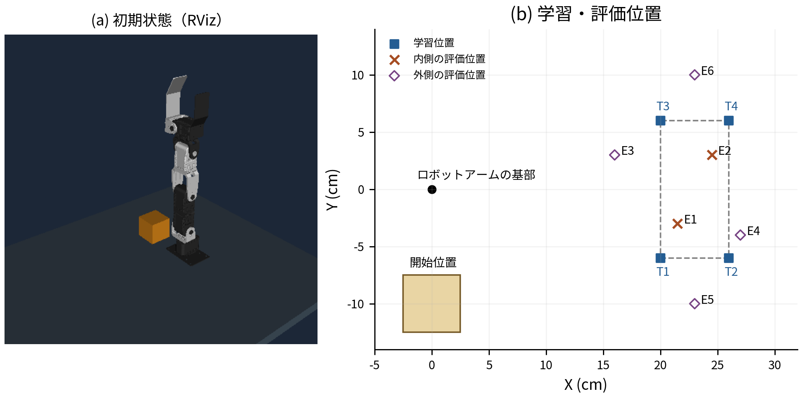

# ロボットアームの搬送動作学習と評価

ROS 2・Gazebo上で、4か所への搬送動作を記録して学習し、別の置き先への関節指令を生成する。
学習と指令生成の処理は [src/cartesian_transport.py](src/cartesian_transport.py) にある。

## 実行

Dockerを起動し、リポジトリ直下で実行する。使用環境はROS 2 Humble、Gazebo Fortress、Python 3.10。

```bash
python3 tools/reference.py restore
bash environment/start.sh
docker exec -u ubuntu "${PAI_CONTAINER_NAME:-pai_ros2}" python3 -m pip install --user -r /workspace/requirements.txt
bash environment/cartesian.sh launch
```

このターミナルを残し、別ターミナルで搬送を実行する。

```bash
bash environment/reference.sh run --condition after --goal E6 --method learned --label demo01
```

- `--goal`：評価位置E1〜E6。配置は下図を参照。
- `--condition`：`before`は変更前、`after`は接近時の関節目標をそろえた手本。
- `--method`：`learned`は回帰モデル、`direct`は直接補間・外挿。
- `--label`：保存する試行名。再実行時は別の名前を付ける。出力先は`local/replay/`。



画面で動作を見る場合は、搬送前に別ターミナルで次を実行し、`http://127.0.0.1:6080/`を開く。

```bash
bash environment/view.sh E6
```

## 再学習・評価

```bash
bash environment/reference.sh train --condition before
bash environment/reference.sh train --condition after
bash environment/reference.sh evaluate --condition after --label repeat01
```

同梱データからの再学習結果は`local/retrained/`、新しい評価記録は`local/replay/`に保存する。
保存済みの評価記録を再集計する場合：

```bash
python3 src/summarize_consistent.py --root . --out local/summary
```

## ファイル

| 場所 | 内容 |
|---|---|
| `src/cartesian_transport.py` | 手本の記録、学習、関節指令の生成と実行 |
| `src/pick_place_demo.py` | ROS 2との接続、初期化、指令送信、成功判定 |
| `src/prepare_*.py` | 手本を作る動作計画の準備・変更 |
| `src/consistent_transport.py` | 変更前後の比較実験を実行した処理 |
| `src/summarize_consistent.py` | 保存記録の集計 |
| `tools/` | データ展開・再学習・搬送・評価の実行入口と画面表示 |
| `environment/` | Dockerとシミュレータの起動設定 |
| `reference_data/recorded_experiment.zip` | 手本、学習済みモデル、全評価記録。`restore`で`local/outputs/`へ展開 |

ロボットと元の動作計画には[crane_plus](https://github.com/AI-Robot-Book-Humble/crane_plus)を使用。[既存コードの利用条件](licenses/Apache-2.0.txt)。
